**English** · [Українська](findings.uk.md)

# Bug report — Virtual Data Room

I tested the live version (commit `9c85149`) on 2026-10-20, in two rounds. The second round re-checked every bug the way a normal user would hit it, and closed the gaps of the first round (real drag-and-drop, upload progress, the Move and Rename dialogs, sharing a whole room, log-in links).

| | |
|---|---|
| Site | https://virtual-data-room-ten.vercel.app |
| API | https://virtual-data-room-production.up.railway.app |
| Accounts used | the owner `john@example.com`, the second user `viewer@example.com`, and one new account I registered for F-21 |

**How to read the scales:**
- **Severity** is how much damage the bug does: Critical, High, Medium, Low.
- **Priority** is how soon to fix it: High = before release, Medium = next iteration, Low = backlog.
- **"How to reproduce"** gives short steps for every bug and says whether a normal user can hit it in the UI, or only someone who calls the API directly. I checked every bug for this, and it changed several priorities.
- The **Autotest** column gives the ID of the automated test that reproduces the bug (for example `BUG-02`); "no" means I checked it by hand only. All tests and their files are listed in [autotests.md](autotests.md).

## Summary

28 bugs:
- 1 high priority;
- 5 medium priority;
- 22 low priority.

There are also 3 design risks.

**Most important (F-21):** if the owner shares a folder with an email that has no account yet, anyone who registers with that email first gets the folder. The app never checks that the person owns the email. I confirmed this end to end on the live site.

## All bugs, by priority
In "How to reproduce" the first word says where the bug happens: **UI** means anyone can do it in the browser, **API** means you need to call the API directly (for example with Postman or curl).

### High priority — fix before release
| ID | Bug | How to reproduce | Severity | Autotest |
|---|---|---|---|---|
| **F-21** | Anyone can take a share meant for someone else: sign up with the invited email before that person does. No email check | **UI**<br>1. Owner: Share a folder → type an email that has **no account yet** (e.g. `new.lawyer@company.com`) → Share.<br>2. In another browser: Sign up with exactly this email and any password.<br>3. Open "Shared with me" → the folder is there and opens. | **Critical** | no |

### Medium priority
| ID | Bug | How to reproduce | Severity | Autotest |
|---|---|---|---|---|
| F-02 | The server does not check the uploaded file. Any content renamed to `.pdf` is stored and shown as a PDF. The 50 MB limit only checks the size the client *says*, not the real size | **UI (content)**<br>1. Take any non-PDF file (e.g. `notes.txt`) and rename it to `notes.pdf`.<br>2. Upload it → it is accepted and listed as a PDF.<br>3. Open it → "Failed to load PDF document".<br>**API (size)**<br>1. `POST /files/upload-intent` with `"size": 10`.<br>2. Upload a bigger file to the returned `uploadUrl`, then `POST /files/{id}/complete` → 201, the real size is saved. | High | ✅ BUG-09, BUG-10 |
| F-10 | Several requests at the same moment create several public links for one folder. The Share window shows only one of them, so "Revoke public link" leaves the others working | **API**<br>1. Send `POST /shares` with `"mode": "PUBLIC_LINK"` for the same folder 3 times at the same moment.<br>2. `GET /shares?resourceType=FOLDER&resourceId=…` → 3 active links.<br>3. UI: Share → "Revoke public link" → the window now shows another link, and it still opens.<br>(A normal human double-click does not reproduce it; the button gets blocked.) | High | ✅ BUG-02, E2E-06 |
| F-01 | If one upload contains two files with the same name, both keep that name, with no "(1)". This breaks the requirement "resolve name conflicts" | **UI**<br>1. Put two different files called `report.pdf` in two folders on your computer.<br>2. Drag both into one folder of the data room at once (or select both from a Finder search).<br>3. Both are listed as `report.pdf`, no "(1)". | Medium | ✅ BUG-01 |
| F-03 | Names can contain invisible and "direction-flipping" characters. `invoice‮fdp.exe` is displayed as "invoiceexe.pdf", and two folders can look exactly the same | **UI**<br>1. New folder → paste the name `invoice‮fdp.exe` (it contains the hidden character U+202E) → Create.<br>2. The list shows "invoiceexe.pdf".<br>3. Create `case-1`, then `case-1` + an invisible zero-width space → both are accepted and look the same. | Medium | ✅ BUG-11 |
| F-22 | If the internet drops at the very end of an upload, **Retry never works**: it always says "Upload failed with status 400". Uploading the file again gives `name (1).pdf`, because the stuck upload still holds the name (F-12) | **UI**<br>1. Start uploading a PDF.<br>2. The connection drops right when the upload finishes (for the test I cut the final "complete" request).<br>3. Click Retry → "Upload failed with status 400", every time.<br>4. Upload the same file again → it is saved as `name (1).pdf`. | Medium | ✅ E2E-08 |

### Low priority
| ID | Bug | How to reproduce | Autotest |
|---|---|---|---|
| F-11 | 5–10 requests at the same moment to create folder "X" create 5–10 folders "X" | **API**<br>1. Send `POST /folders` with the same name and parent 5 times at the same moment.<br>2. All answer 201 → 5 identical folders.<br>(In the UI a double-click on "Create" makes only one.) | ✅ BUG-03 |
| F-12 | An upload that never finished still "holds" its name. The next `ghost.pdf` becomes `ghost (1).pdf` in a folder that looks empty | **UI**<br>1. Start uploading a big PDF (e.g. 40 MB) and close the tab before it finishes.<br>2. Open the folder again → the file is not there.<br>3. Upload the same file again → it is called `name (1).pdf`. | ✅ BUG-04 |
| F-13 | Unknown fields in a request are ignored instead of rejected. A typo `targetFolderID` silently moves the file to the top level of the room | **API**<br>1. `PATCH /files/{id}/move` with `{"targetFolderID": "<folder id>"}` (capital "D", a typo).<br>2. Answer 200 → the file is now at the top of the room, not in that folder. | ✅ BUG-05 |
| F-14 | Three cases return a server error (500) instead of a normal error: a NUL character in a name, deleting the same file twice at the same moment, and "complete upload" before the file was uploaded | **API**<br>1. `POST /folders` with the name `"a\u0000b"` → 500.<br>2. Send `DELETE /files/{id}` 3 times at the same moment → 204, 500, 500.<br>3. `POST /files/upload-intent`, then `POST /files/{id}/complete` without uploading → 500. | ✅ BUG-06, BUG-07, BUG-08 |
| F-04 | The API lets you rename `report.pdf` to `report.exe` or remove the extension. The UI does not allow it | **API**<br>1. `PATCH /files/{id}` with `{"name": "report.exe"}`.<br>2. Answer 200 → the file is now called `report.exe`. | ✅ BUG-12 |
| F-05 | The owner can share a folder with their own email. It then appears in their own "Shared with me" | **UI**<br>1. Open Share for your own folder.<br>2. Type your own email → Share → "Shared with you@…".<br>3. Open "Shared with me" → your own folder is there. | ✅ BUG-13 |
| F-15 | After Sign out in one tab, other open tabs still show the old folder list. The first click or a refresh sends you to the login page, so no new data is shown | **UI**<br>1. Open the data room in two tabs.<br>2. Sign out in tab 1.<br>3. Look at tab 2 → the folders and files are still shown until the next click. | no |
| F-16 | A viewer opens a file shared with them, refreshes the page (F5) and clicks Close (X). They get "Data room not found" instead of going back. Without the refresh, Close works fine | **UI**<br>1. As the second user: "Shared with me" → open a file that was shared on its own.<br>2. Press F5.<br>3. Click Close (X) → "Data room not found". | no |
| F-17 | Error texts show whether an item exists: "Resource not found" means it exists but is not yours, "Folder not found" means it does not exist. The API docs promise they look the same | **API**<br>1. As the second user: `GET /folders/{the owner's folder id}/contents` → "Resource not found".<br>2. `GET /folders/{random id}/contents` → "Folder not found". | ✅ BUG-14 |
| F-07 | The public link info returns the internal room id to anonymous visitors | **API**<br>1. Create a public link.<br>2. Without logging in: `GET /public/{token}` → the answer contains `dataRoomId`. | no |
| F-06 | An empty (0 byte) PDF shows the raw technical message "size must not be less than 1" | **UI**<br>1. Create an empty file `empty.pdf` (0 bytes).<br>2. Upload it → the panel shows "size must not be less than 1". | no |
| F-09 | The "Link not available" page has a Retry button that can never help | **UI**<br>1. Open `https://virtual-data-room-ten.vercel.app/share/wrong-link`.<br>2. "Link not available" + Retry → Retry shows the same page. | no |
| F-18 | The built-in PDF viewer shows a technical id (`e247c0c7-…`) as the document title instead of the file name | **UI**<br>1. Open any PDF in the viewer (Chrome).<br>2. The viewer's title bar shows an id like `e247c0c7-…`, not the file name. | no |
| F-19 | On a phone-width screen, a long name without spaces makes the table wider than the screen, so the actions (⋮) are hidden. On a laptop it looks fine (checked at 1512 px) | **UI, phone**<br>1. Create a folder with a long name without spaces, e.g. `Due_Diligence_Financial_Statements_2023-2025_Audited`.<br>2. Open the room on a phone (or a 375 px wide window) → the ⋮ actions are off screen; you must scroll the table sideways. | no |
| F-20 | The delete-folder warning does not say that the folder is shared with people or by link | **UI**<br>1. Share a folder with someone.<br>2. Click Delete for this folder → the warning lists the files but says nothing about the share. | no |
| F-08 | Dates follow the browser language ("20 жовт. 2026 р.") while the rest of the UI is English | **UI**<br>1. Use a browser set to a non-English language (e.g. Ukrainian).<br>2. Open any folder → dates look like "20 жовт. 2026 р." in the English interface. | no |
| F-23 | "Shared with me" does not say who shared an item. Every room is called "My Data Room" and cannot be renamed, so a room someone shared with you shows up as "My Data Room" | **UI**<br>1. The owner shares the whole room with a user.<br>2. The user opens "Shared with me" → sees "My Data Room", with no owner name. | no |
| F-24 | Folders can be nested only 72 levels deep. Level 73 fails with a server error (500) instead of a clear message | **API** (or UI, folder inside folder)<br>1. Create folders one inside another.<br>2. Level 73 → 500 "Internal server error". | no |
| F-25 | Data rooms: the API accepts a room name made only of spaces (saved as an empty name) and allows several rooms, but the UI shows only the first room. "My data rooms" opens just that one; other rooms open only by direct address; rooms cannot be renamed | **API + UI**<br>1. `POST /data-rooms {"name": "   "}` → 201, name `""`.<br>2. `POST /data-rooms {"name": "Project Phoenix"}` → 201.<br>3. UI: "My data rooms" shows only "My Data Room"; the other two open only by `/room/<id>`. | no |
| F-26 | Inside a public link there is no path. Deep in the folders the visitor does not see where they are, and "Back" jumps to the top, not one level up | **UI**<br>1. Share a folder with subfolders by public link.<br>2. Open the link and go 3 levels deep.<br>3. No path and no folder name; "Back to <top folder>" returns to the top. | no |
| F-27 | Missing security headers: any site can show the data room inside a frame (no `X-Frame-Options` / CSP), which allows clickjacking; the API tells everyone it runs "Express" | **API**<br>1. `curl -I https://virtual-data-room-ten.vercel.app` → no `X-Frame-Options`, no `Content-Security-Policy`.<br>2. `curl -I …railway.app/health` → `X-Powered-By: Express`. | ✅ BUG-15 |
| F-28 | After logging in you always land on the home page, not on the link you opened | **UI**<br>1. While logged out, open a link to a folder.<br>2. You get the login page; log in.<br>3. You are on the home page, not in that folder. | ✅ E2E-07 |

### Design risks (not bugs, but need a decision)
| ID | Risk |
|---|---|
| R-02 | A file link that a viewer already opened keeps working for up to 5 minutes after access is revoked |
| R-03 | The login token is valid for 7 days and is kept in the browser's localStorage. "Sign out" does not cancel it on the server. If the token is stolen, it works for a week |
| R-04 | There is no limit on login or sign-up attempts, so passwords can be guessed by brute force. Sign-up also says "email already exists", so anyone can check which emails have accounts. Found in the code; I did not attack the live site |

## What works well
All of this was checked, and most of it is covered by automated tests.
- **The viewer cannot change anything.** All 12 ways to change data return 404. The viewer also cannot open the owner's other folders and files by changing the id in the address (IDOR).
- **A public link shows only what was shared.** You cannot reach the parent folder, sibling folders or other files with it.
- **Revoke works at once.** The link says "This link has been revoked". If the viewer has the folder open, their next click shows "you don't have access".
- **Folders:**
  - duplicate names are blocked, ignoring capital letters and spaces;
  - the 200-character limit works;
  - the breadcrumbs (the path at the top) are correct;
  - the delete warning shows how many folders and files will be deleted.
- **Files:**
  - name conflicts get "(1)", "(2)" on upload, rename and move;
  - view and download work;
  - a download has the right file name.
- **Uploading:**
  - wrong types and files over 50 MB are rejected with a clear message;
  - real drag-and-drop from the computer works (checked by hand);
  - every file has its own progress bar.
- **Move and Rename dialogs:** the folder tree works and the current folder is disabled; rename keeps `.pdf` and explains a name conflict ("Renamed to "big-30mb (1).pdf" to avoid a naming conflict").
- **Sharing a whole room:** the recipient sees all folders, read-only.
- **Fixed regressions from the product README:**
  - Enter on a Download button only downloads;
  - after sign-out and a new login, the previous user's data is not shown.
- **CORS:** other sites cannot call the API.
- **Security basics:**
  - HTML in names is shown as text, not run;
  - login gives the same message for a wrong password and an unknown email.

---

## Details of high and medium bugs

### F-21 — Anyone can take a share meant for an unregistered email
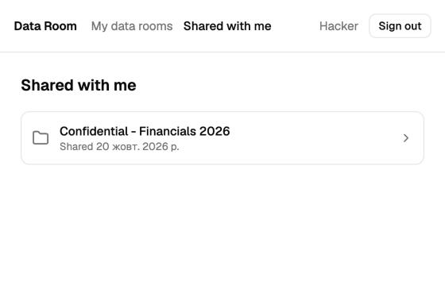

**Steps:**
1. The owner shares the folder "Confidential - Financials 2026" with `cfo.n5qa6468@example.com`. No account exists for this email yet, and the app allows the share.
2. Someone else opens Sign up and registers with exactly this email and any password.
3. They open "Shared with me".

**Expected:** the share reaches only the real owner of the email. For example, sign-up asks to confirm the email first, or a share to an unknown email is not allowed.

**Actual:** the account works right away, with no email confirmation. The confidential folder is already in "Shared with me" and opens.

**Why it matters:** in a deal it is normal to invite people who have no account yet, such as lawyers or auditors of the buyer. Anyone who knows or guesses their work email can get the documents first.

### F-02 — Uploaded files are not checked on the server
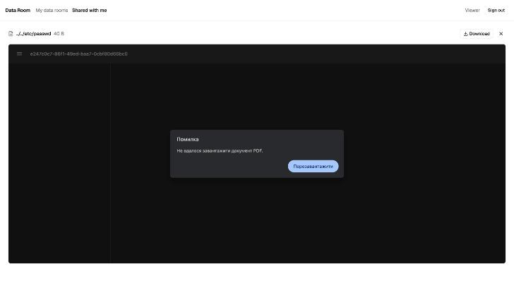

**Steps:** rename any non-PDF file to `something.pdf` and upload it.

**Expected:** the server checks that the file really is a PDF (it starts with `%PDF-`) and checks its real size.

**Actual:**
- The file is saved and shown as a PDF. Viewers get "Failed to load PDF document".
- With the API you can also say "the file is 10 bytes" and then upload a bigger one. It is saved with its real size, so the 50 MB limit does not protect anything.

**Why it matters:**
- A data room should only hold real documents.
- Since anyone can sign up (see F-21), anyone can also fill the storage with big files.

### F-10 — Two public links for one folder; Revoke closes only one
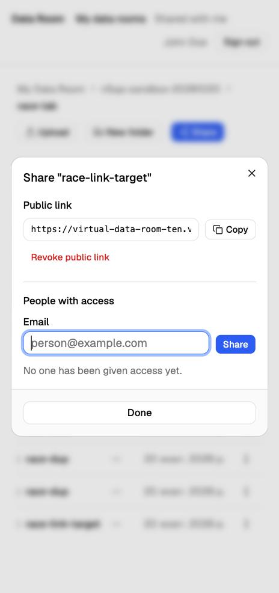

**Steps:** send two "create public link" requests for the same folder at the same moment (an automated double-click, or a script). Then click "Revoke public link" in the Share window.

**Expected:** one link per folder. After Revoke, no link works.

**Actual:**
- 2 links are created. The window shows one of them.
- After Revoke, it quietly shows the second link, which still opens the folder.
- With 6 requests at once: 6 links, and 5 still work after Revoke.

**How likely:** I clicked the button twice quickly by hand, and the UI blocked the second click. So a normal user will rarely hit this. It still matters because when it happens, the owner thinks access is closed and it is not.

**Fix idea:** allow only one active link per item in the database, and make Revoke close all of them.

### F-01 — Same-name files in one upload are not renamed
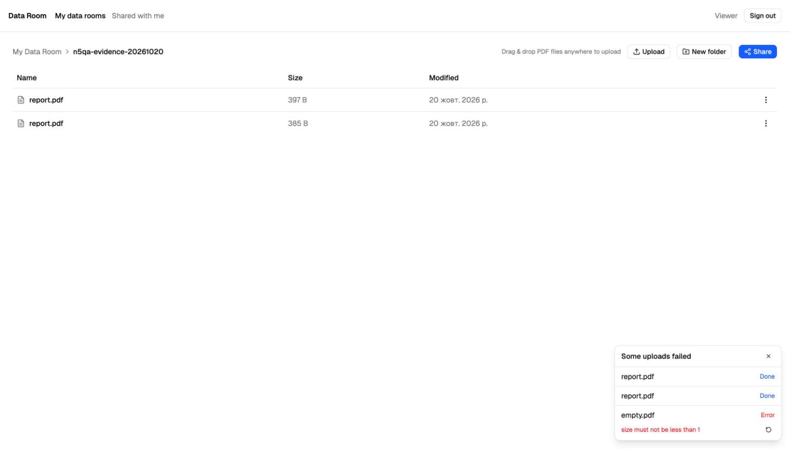

**Steps:** in one upload, select two files called `report.pdf` from different folders (or drag them together).

**Expected:** the second becomes `report (1).pdf`, the same as when you upload them one after another.

**Actual:** both are saved as `report.pdf`, and there is no way to tell them apart.

### F-03 — Invisible and direction-flipping characters in names
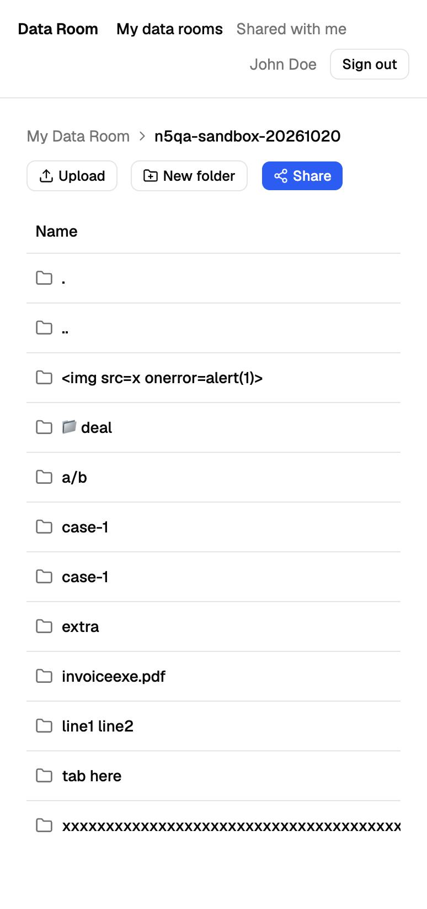

**Steps:** create folders or files with these names:
- `invoice` + the right-to-left mark (U+202E) + `fdp.exe`
- `case-1` + an invisible zero-width space
- names with a tab or a line break

**Expected:** these characters are rejected or removed.

**Actual:**
- all of them are accepted;
- the first name is displayed as "invoiceexe.pdf", although it really ends with ".exe";
- two `case-1` folders look identical.

### F-22 — Retry never finishes an upload after a network drop
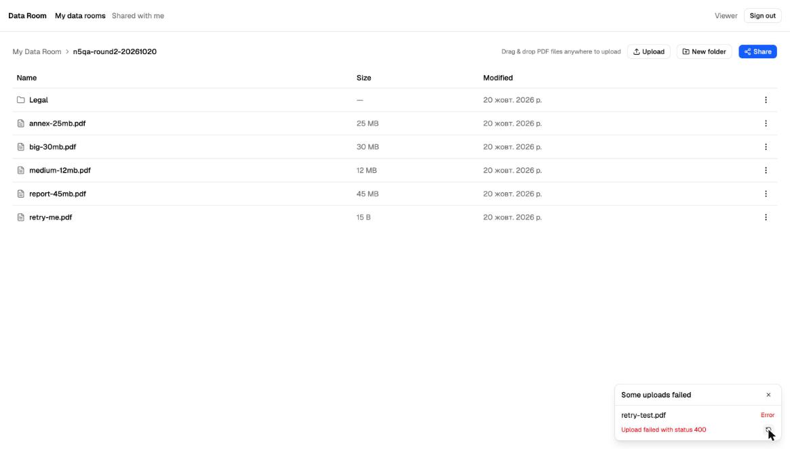

**Steps:**
1. Start uploading a PDF.
2. Lose the connection right when the bytes are uploaded. For the test, I made the last request ("complete") fail with a network error.
3. The panel shows "Error: Network Error". Click Retry.

**Expected:** Retry finishes the upload.

**Actual:**
- "Upload failed with status 400", on every Retry.
- The file stays invisible. Uploading it again gives `retry-test (1).pdf`, because the stuck upload still holds the name (F-12).

**Why:** Retry uploads the file bytes again, but storage already has them and does not allow overwriting.

**Why it matters:** on mobile or hotel Wi-Fi this happens. The user cannot finish the upload, and gets a confusing "(1)" name when trying again.

---

## Screenshots of low-priority bugs

**F-05 — the owner shares a folder with their own email** (logged in as "Viewer", sharing with viewer@example.com):

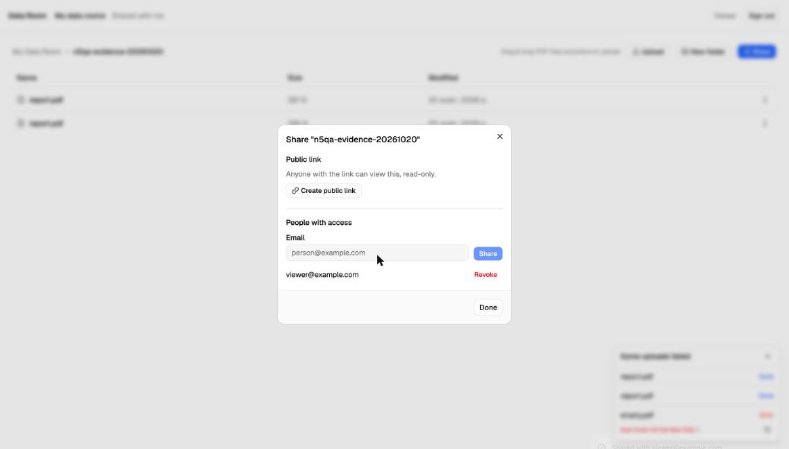

**F-05 — and the folder then appears in their own "Shared with me":**

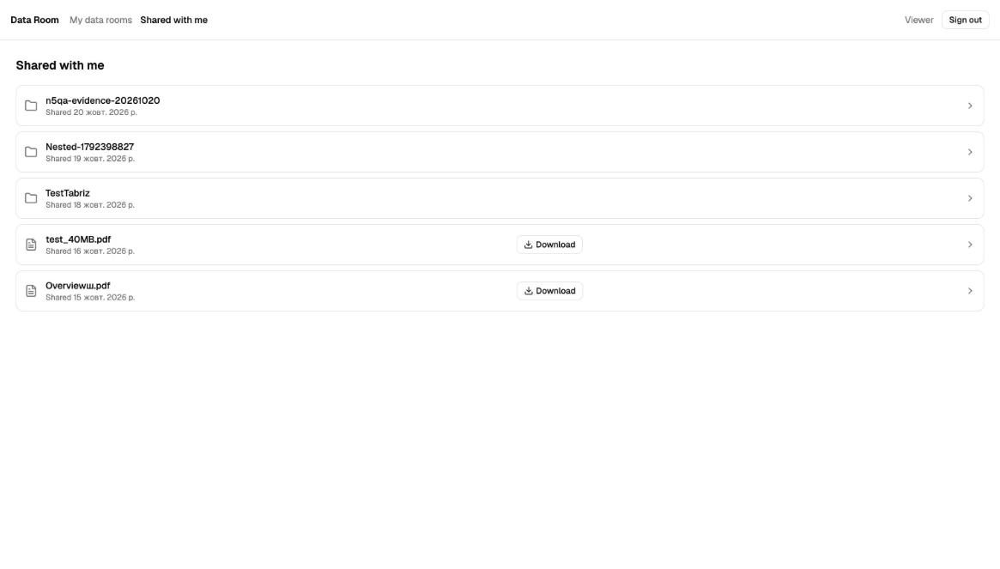

**F-06 and F-08** are on the F-01 screenshot above:
- F-06: the upload panel shows the raw text "size must not be less than 1";
- F-08: the dates are in Ukrainian.

**F-09 — "Link not available" with a Retry button that cannot help:**

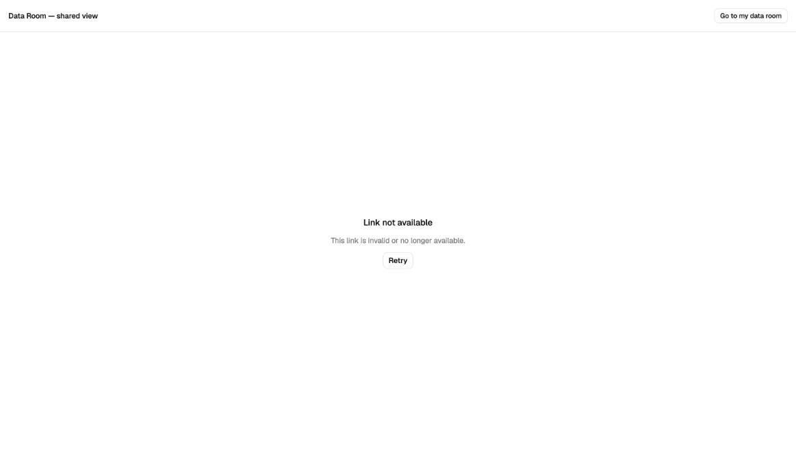

**F-16 — Close after a refresh of the file page leads to "Data room not found":**

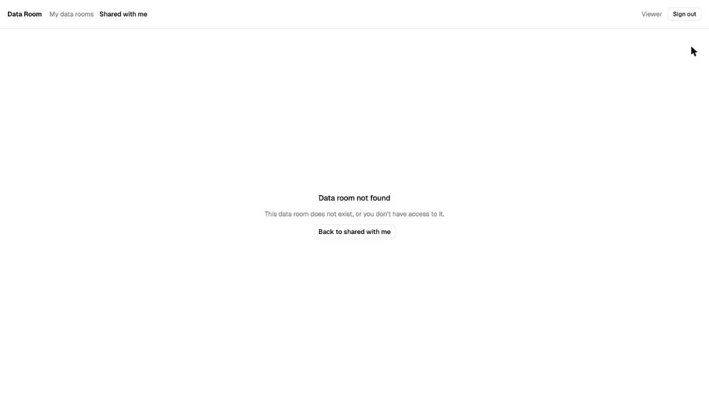

**F-18** is on the F-02 screenshot above: the viewer's title is a technical id, not the file name.

**F-19 — on a phone (375 px) a long folder name pushes the columns and the actions (⋮) off the screen:**

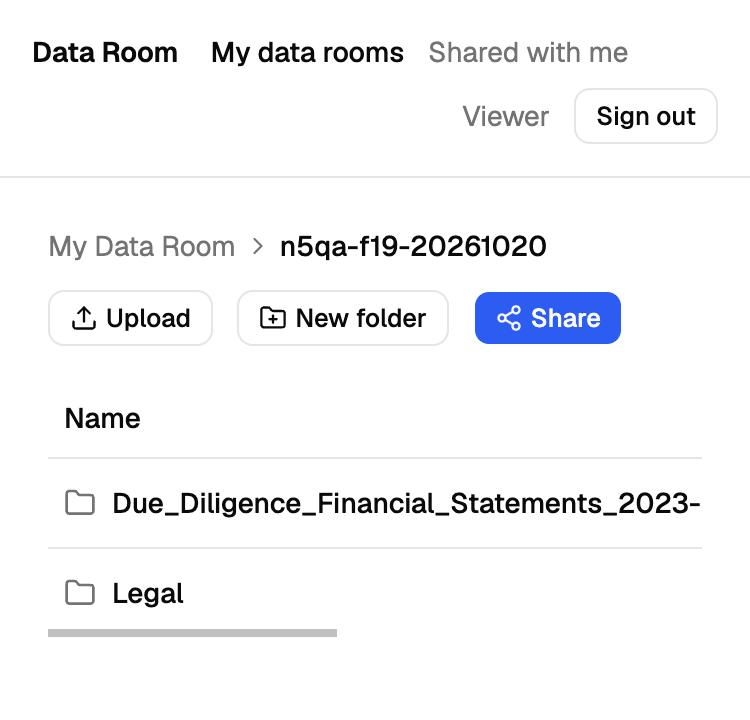

**F-20 — the delete warning says "2 files" but not that this folder is shared with someone:**

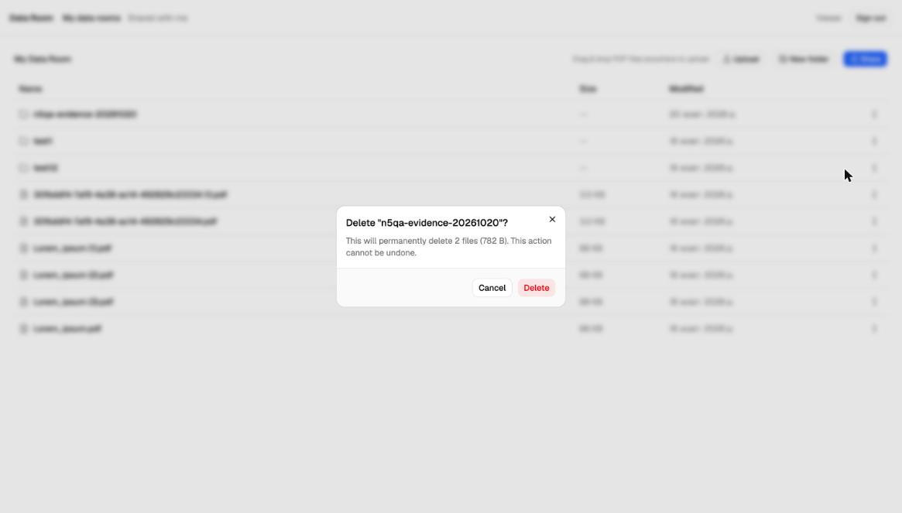

**F-23 — someone else's room appears as "My Data Room", with no owner:**

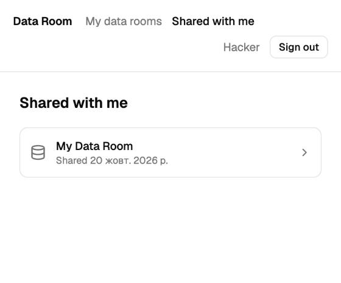

**F-26 — 3 levels deep in a public link: no path, and Back goes to the top:**

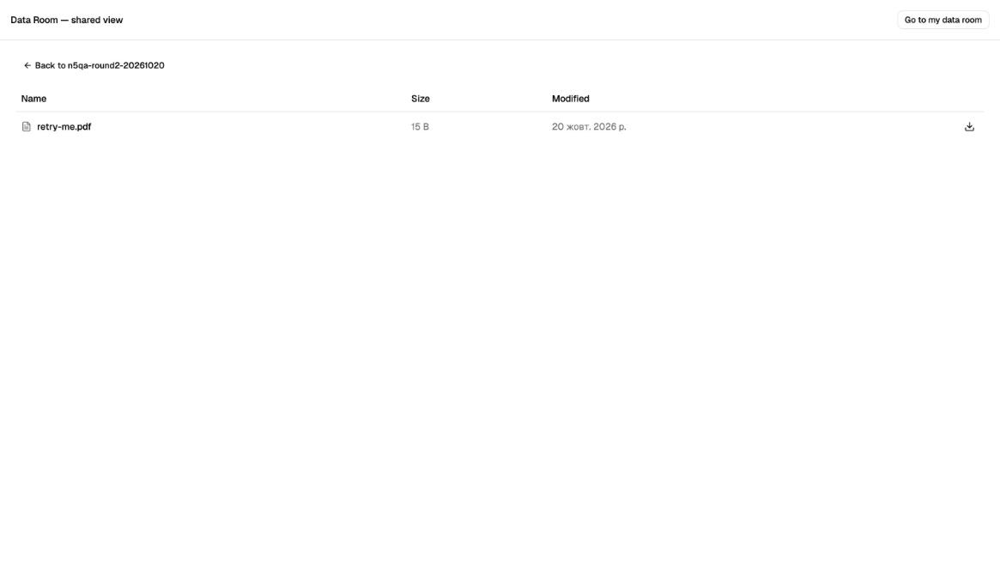

## API proof for bugs you cannot see in the UI
These are the real requests and answers from the live API on 2026-10-20. Ids are shortened.

**F-11 — 10 creates of the same folder at the same moment:**
```
POST /folders {"name":"race-dup", ...}  x10 in parallel
→ 201, 201, 201, 201, 201, 201, 201, 201, 201, 201   (10 folders "race-dup")
```

**F-12 — an upload that was never finished keeps its name:**
```
POST /files/upload-intent {"name":"ghost.pdf", ...}   → 201 {"name":"ghost.pdf"}       (file never uploaded)
POST /files/upload-intent {"name":"ghost.pdf", ...}   → 201 {"name":"ghost (1).pdf"}
GET  /folders/{id}/contents                           → {"items":[]}                  (folder looks empty)
```

**F-13 — a typo in a field name moves the file to the top of the room:**
```
PATCH /files/{id}/move {"targetFolderID":"<folder id>"}   (should be targetFolderId)
→ 200 {"folderId": null, ...}
```

**F-14 — server errors instead of normal errors:**
```
POST   /folders {"name":"nul\u0000name", ...}       → 500 {"message":"Internal server error"}
DELETE /files/{id}  x3 at the same moment           → 204, 500, 500
POST   /files/{id}/complete  (nothing uploaded)     → 500 {"message":"Could not verify the upload"}
```

**F-17 — the error text shows whether an item exists** (as the second user):
```
GET /folders/{owner's folder}/contents   → 404 {"message":"Resource not found"}
GET /folders/{random id}/contents        → 404 {"message":"Folder not found"}
```

**F-04 — the API allows another extension:**
```
PATCH /files/{id} {"name":"report.exe"}   → 200 {"name":"report.exe", "mimeType":"application/pdf"}
```

**F-24 — folders 73 levels deep:**
```
POST /folders {"name":"L1"} … {"name":"L72", "parentId":"<L71>"}   → 201 each
POST /folders {"name":"L73", "parentId":"<L72>"}                  → 500 {"message":"Internal server error"}
```

**F-25 — a room with a blank name, and rooms the UI never shows:**
```
POST /data-rooms {"name":"   "}              → 201 {"name":""}
POST /data-rooms {"name":"Project Phoenix"}  → 201
GET  /data-rooms                             → ["My Data Room", "", "Project Phoenix"]
UI "My data rooms"                           → shows only "My Data Room"
```

**F-27 — security headers:**
```
GET https://virtual-data-room-ten.vercel.app/       → no X-Frame-Options, no Content-Security-Policy
GET https://…railway.app/health                     → X-Powered-By: Express
GET …/health with Origin: https://evil.example      → no Access-Control-Allow-Origin (CORS is fine)
```

**F-07 — the public link info shows the internal room id to anyone:**
```
GET /public/{token}   (no login)
→ 200 {"resourceType":"FOLDER","resourceName":"share-root","dataRoomId":"05f75e29-…", ...}
```

## Screenshots of things that work well

**The second user sees the shared folder read-only.** There is no Upload, New folder or Share:

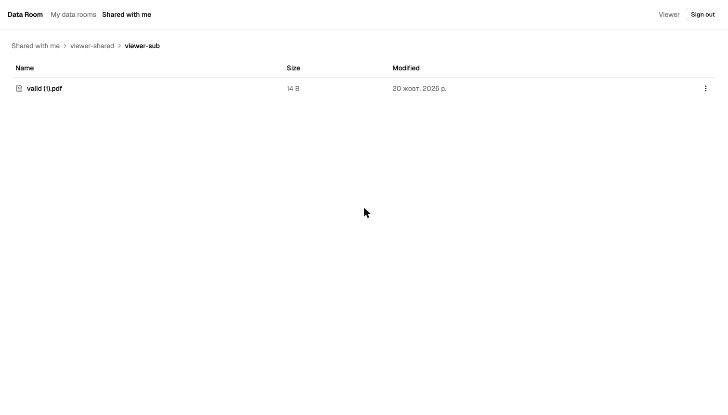

**The owner revoked access while the second user had the folder open.** The next click shows a clear message:

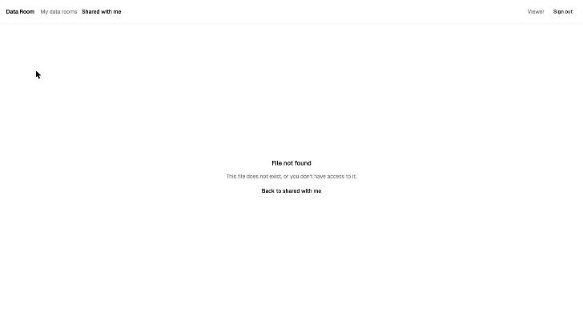

**A revoked public link shows a clear page:**

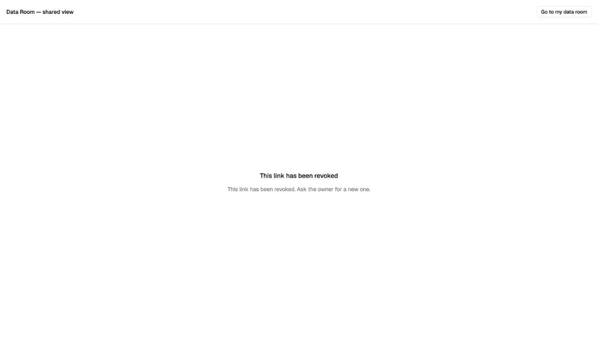

**Every file has its own progress bar (45 MB and 25 MB uploading at once):**

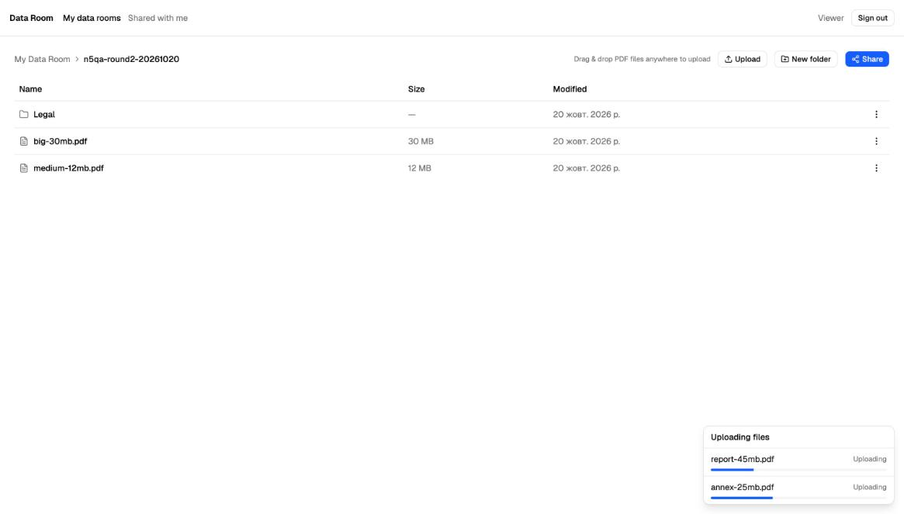

**Real drag-and-drop from Finder: the two PDFs are uploaded, the .txt file is refused:**

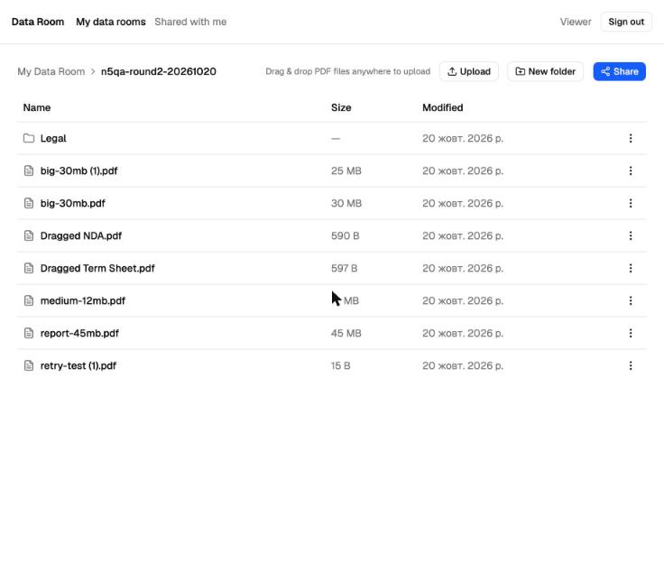
